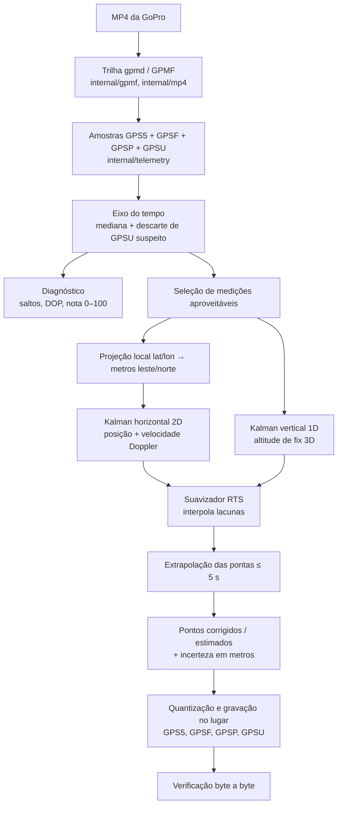
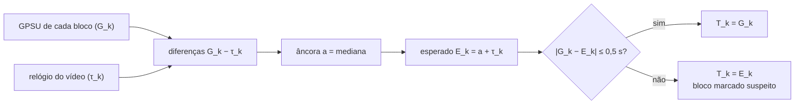
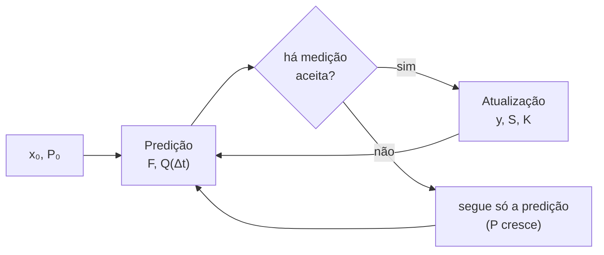
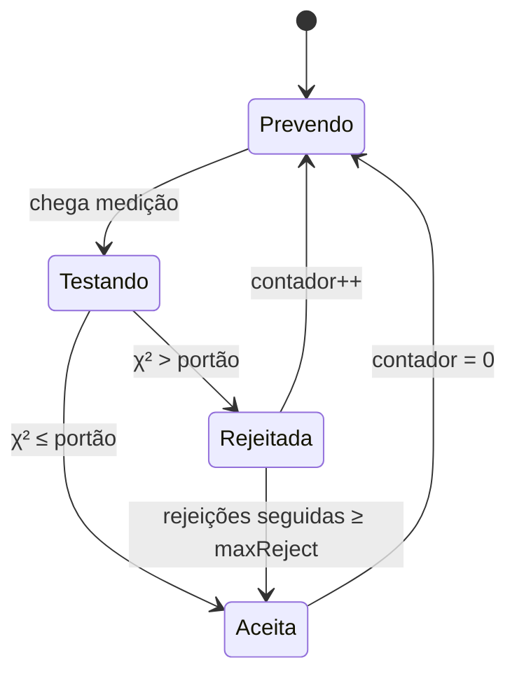
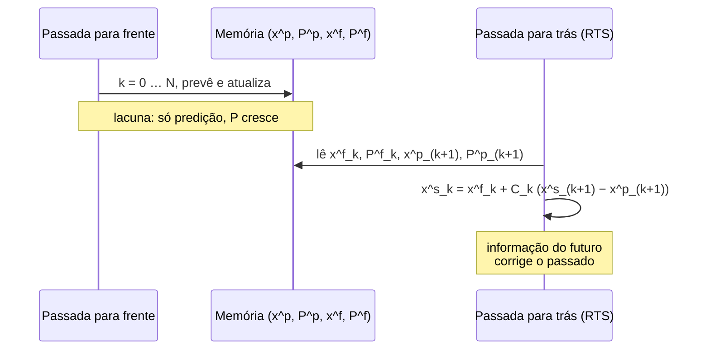

# Técnicas matemáticas do gopro-gps-repair

Este documento descreve, com fórmulas e diagramas, toda a matemática que o
programa usa para **medir**, **corrigir** e **interpolar** a telemetria GPS de um
vídeo GoPro. Cada seção aponta o arquivo e a função onde a técnica está
implementada.

> As fórmulas usam a sintaxe LaTeX (`$...$` e `$$...$$`) e os diagramas usam
> Mermaid, ambos renderizados pelo GitHub e pela maioria dos editores Markdown.

## Sumário

1. [Visão geral do pipeline](#1-visão-geral-do-pipeline)
2. [Decodificação dos dados brutos (GPMF)](#2-decodificação-dos-dados-brutos-gpmf)
3. [Reconstrução do eixo do tempo](#3-reconstrução-do-eixo-do-tempo)
4. [Geometria: distância e projeção local](#4-geometria-distância-e-projeção-local)
5. [Diagnóstico: detectando o que está ruim](#5-diagnóstico-detectando-o-que-está-ruim)
6. [Seleção das medições aproveitáveis](#6-seleção-das-medições-aproveitáveis)
7. [Modelo de incerteza das medições](#7-modelo-de-incerteza-das-medições)
8. [Filtro de Kalman de velocidade constante](#8-filtro-de-kalman-de-velocidade-constante)
9. [Rejeição de saltos (portão de Mahalanobis)](#9-rejeição-de-saltos-portão-de-mahalanobis)
10. [Velocidade Doppler: filtro de Kalman estendido](#10-velocidade-doppler-filtro-de-kalman-estendido)
11. [Suavizador RTS: interpolação das lacunas](#11-suavizador-rts-interpolação-das-lacunas)
12. [Extrapolação das pontas](#12-extrapolação-das-pontas)
13. [Altitude: o canal vertical](#13-altitude-o-canal-vertical)
14. [Incerteza reportada e correção por correlação](#14-incerteza-reportada-e-correção-por-correlação)
15. [Gravação: quantização e valores declarados](#15-gravação-quantização-e-valores-declarados)
16. [Álgebra linear usada](#16-álgebra-linear-usada)
17. [Tabela de parâmetros](#17-tabela-de-parâmetros)
18. [Limitações e hipóteses](#18-limitações-e-hipóteses)
19. [Referências](#19-referências)

---

## 1. Visão geral do pipeline



A ideia central: o receptor GPS da câmera produz **medições ruidosas e às vezes
inválidas**. O programa trata a trajetória como um **processo dinâmico** (um
corpo que se move com velocidade quase constante) e usa estatística bayesiana
para combinar o modelo de movimento com as medições, pesando cada medição pela
sua confiabilidade.

---

## 2. Decodificação dos dados brutos (GPMF)

Arquivos: `internal/gpmf/gpmf.go`, `internal/telemetry/telemetry.go`.

O GPS é gravado como `GPS5`: para cada amostra, cinco inteiros de 32 bits com
sinal (latitude, longitude, altitude, velocidade 2D, velocidade 3D). A escala
vem do campo `SCAL` do mesmo bloco:

$$
\text{valor}_c = \frac{\text{inteiro}_c}{\text{SCAL}_c}, \qquad c \in \{\text{lat},\text{lon},\text{alt},v_{2D},v_{3D}\}
$$

Os campos `GPSF` (tipo de fix: 0 = nenhum, 2 = 2D, 3 = 3D) e `SCAL` são
"pegajosos": se um bloco não os repete, vale o último visto.

`GPSP` guarda o **DOP** (diluição de precisão) multiplicado por 100:

$$
\text{DOP} = \frac{\text{GPSP}}{100}
$$

Uma amostra é considerada **válida** se não for $(0,0)$ e se
$|\varphi| \le 90^\circ$ e $|\lambda| \le 180^\circ$.

---

## 3. Reconstrução do eixo do tempo

Arquivo: `internal/telemetry/telemetry.go`, função `assignTimes`.

Cada bloco (~1 s, ~18 amostras) tem dois relógios:

- o **relógio do vídeo** $\tau_k$ (instante do payload no MP4), perfeitamente
  regular;
- o **horário GPS** $G_k$ (campo `GPSU`, UTC), que pode estar errado quando o
  receptor perde o fix.

### Âncora por mediana

A diferença entre os dois relógios deveria ser constante. O programa estima essa
constante pela **mediana**, que é robusta a valores aberrantes:

$$
a = \operatorname{mediana}_k \left( G_k - \tau_k \right)
$$

(usando só blocos com fix; se não houver nenhum, usa todos).

### Descarte de horário suspeito

O horário esperado do bloco é $E_k = a + \tau_k$. Se

$$
|G_k - E_k| > 0{,}5\ \text{s}
$$

o `GPSU` é marcado como **suspeito** e substituído por $E_k$. Esses blocos
podem ter o `GPSU` regravado no arquivo de saída.

### Distribuição das amostras dentro do bloco

As $n_k$ amostras do bloco $k$ são espaçadas uniformemente até o horário do
bloco seguinte:

$$
t_{k,j} = T_k + j \cdot \frac{T_{k+1} - T_k}{n_k}, \qquad j = 0,\dots,n_k-1
$$

onde $T_k$ é o horário final adotado do bloco. No último bloco usa-se a duração
do payload no lugar de $T_{k+1}-T_k$.



---

## 4. Geometria: distância e projeção local

Arquivo: `internal/geo/geo.go`.

### Distância de grande círculo (fórmula de haversine)

Para dois pontos $(\varphi_1,\lambda_1)$ e $(\varphi_2,\lambda_2)$, com raio
médio da Terra $R = 6\,371\,008{,}8$ m:

$$
a = \sin^2\!\frac{\Delta\varphi}{2} + \cos\varphi_1\cos\varphi_2\,\sin^2\!\frac{\Delta\lambda}{2}
$$

$$
d = 2R\,\arcsin\!\left(\min\left(1,\sqrt{a}\right)\right)
$$

O `min(1, …)` protege contra erro de arredondamento. A haversine é
numericamente estável para distâncias pequenas (diferente da lei dos cossenos).

### Projeção num plano tangente local

O filtro de Kalman precisa de coordenadas **em metros**, onde distâncias são
euclidianas. Escolhe-se como origem a primeira posição válida
$(\varphi_0,\lambda_0)$ e usa-se a projeção equirretangular local:

$$
e = R\,(\lambda - \lambda_0)\cos\varphi_0, \qquad n = R\,(\varphi - \varphi_0)
$$

(ângulos em radianos). A inversa, usada para voltar a latitude/longitude:

$$
\varphi = \varphi_0 + \frac{n}{R}, \qquad \lambda = \lambda_0 + \frac{e}{R\cos\varphi_0}
$$

Para trechos de poucos quilômetros o erro dessa aproximação é desprezível
(o fator $\cos\varphi$ é tratado como constante).

```text
          norte (n)
             ▲
             │        • posição (e, n)
             │      ╱
             │    ╱
             │  ╱
   origem ───●────────────► leste (e)
 (φ0, λ0)
```

---

## 5. Diagnóstico: detectando o que está ruim

Arquivo: `internal/diagnose/diagnose.go`. O diagnóstico não altera nada: ele só
mede os defeitos e dá uma nota.

### 5.1 Salto de posição

Duas amostras consecutivas $i-1$ e $i$ (ambas com fix ≥ 2) têm um **salto** se
o deslocamento observado excede muito o que a velocidade Doppler explica:

$$
\text{excesso}_i = d_i - \bar v_i\,\Delta t_i, \qquad \bar v_i = \frac{v_{2D,i-1} + v_{2D,i}}{2}
$$

$$
\text{salto}_i \iff \text{excesso}_i > 5\ \text{m}
$$

onde $d_i$ é a distância haversine entre as duas posições. A velocidade
Doppler é uma medição **independente** da posição (vem do deslocamento de
frequência do sinal, não da diferença de posições), por isso serve de árbitro.

### 5.2 Salto de altitude

$$
|h_i - h_{i-1}| > 5\ \text{m} \quad \text{e} \quad \Delta t < 0{,}5\ \text{s}
$$

### 5.3 Qualidade de uma amostra

| Condição | Peso $q$ |
|---|---|
| inválida ou sem fix | 0 |
| fix 2D | 0,3 |
| fix 3D, DOP ≤ 2 (ou ausente) | 1,0 |
| fix 3D, 2 < DOP ≤ 5 | 0,8 |
| fix 3D, 5 < DOP ≤ 10 | 0,5 |
| fix 3D, DOP > 10 | 0,2 |

Salto de posição zera o peso; salto de altitude o multiplica por 0,5.

### 5.4 Nota global

Média ponderada por amostra, em porcentagem:

$$
\text{nota} = \operatorname{round}\!\left(100 \cdot \frac{1}{N}\sum_{i=1}^{N} q_i\right)
$$

| Nota | Veredito |
|---|---|
| ≥ 85 | bom |
| 50 – 84 | degradado |
| < 50 | ruim |

### 5.5 Outras estatísticas

- **DOP mediano:** mediana dos DOPs dos blocos com fix ≥ 2.
- **Distância percorrida:** soma das distâncias haversine entre amostras de fix
  3D, excluindo saltos.

---

## 6. Seleção das medições aproveitáveis

Arquivo: `internal/reconstruct/reconstruct.go`, função `Run`.

Nem toda amostra entra no filtro. Para o canal **horizontal** a amostra precisa
ser válida, ter fix ≥ 2 e DOP < 50 (DOP ≥ 50 é a câmera dizendo "99,99 = sem
precisão"). Para o canal **vertical** é exigido fix ≥ 3:

$$
\text{posOK}_i = \text{válida}_i \wedge \text{fix}_i \ge 2 \wedge \text{DOP}_i < 50
$$

$$
\text{altOK}_i = \text{válida}_i \wedge \text{fix}_i \ge 3 \wedge \text{DOP}_i < 50
$$

O motivo: com fix 2D o receptor **não mede** a altitude, ele a assume. Esse
valor, mesmo "válido", não é uma medição e contaminaria o filtro.

---

## 7. Modelo de incerteza das medições

Cada medição entra no filtro com um desvio-padrão $\sigma$ crescente com o DOP
(valor ausente é tratado como DOP = 5):

$$
\sigma_{pos} = 1 + 0{,}8\cdot\text{DOP} \quad [\text{m}]
$$

$$
\sigma_{alt} = 3 + 1{,}5\cdot\text{DOP} \quad [\text{m}]
$$

$$
\sigma_{vel} = 0{,}3 + 0{,}05\cdot\text{DOP} \quad [\text{m/s}]
$$

Esses fatores são **empíricos**: o DOP da GoPro é um indicador relativo, não um
erro em metros. A altitude tem incerteza maior porque a geometria dos
satélites é pior na vertical (VDOP > HDOP, pois todos os satélites estão acima
do horizonte).

| DOP | $\sigma_{pos}$ | $\sigma_{alt}$ | $\sigma_{vel}$ |
|---|---|---|---|
| 1 | 1,8 m | 4,5 m | 0,35 m/s |
| 2 | 2,6 m | 6,0 m | 0,40 m/s |
| 5 | 5,0 m | 10,5 m | 0,55 m/s |
| 10 | 9,0 m | 18,0 m | 0,80 m/s |

---

## 8. Filtro de Kalman de velocidade constante

Arquivo: `internal/reconstruct/kalman.go`, função `runCV`.

O filtro de Kalman é o estimador ótimo (mínimos quadrados recursivo) para um
sistema linear com ruído gaussiano. Aqui o sistema é um **modelo de velocidade
constante** (CV) em $d$ dimensões: $d = 2$ para (leste, norte) e $d = 1$ para a
altitude.

### 8.1 Estado

$$
\mathbf{x} = \begin{bmatrix} \mathbf{p} \\ \mathbf{v} \end{bmatrix} \in \mathbb{R}^{2d}
$$

Para o canal horizontal: $\mathbf{x} = [e,\ n,\ v_e,\ v_n]^\top$.

### 8.2 Predição

Entre dois instantes separados por $\Delta t$:

$$
\mathbf{x}_{k|k-1} = F(\Delta t)\,\mathbf{x}_{k-1|k-1}
$$

$$
P_{k|k-1} = F\,P_{k-1|k-1}\,F^\top + Q(\Delta t)
$$

com a matriz de transição (posição avança velocidade × tempo):

$$
F(\Delta t) = \begin{bmatrix} I_d & \Delta t\, I_d \\ 0 & I_d \end{bmatrix}
$$

### 8.3 Ruído de processo (manobras)

Admite-se que a velocidade **não é exatamente constante**: há uma aceleração
aleatória, branca e gaussiana, com desvio-padrão $\sigma_a$. Integrando-a sobre
$\Delta t$ (modelo de aceleração constante por partes), para cada dimensão:

$$
Q(\Delta t) = \sigma_a^2 \begin{bmatrix} \dfrac{\Delta t^4}{4} & \dfrac{\Delta t^3}{2} \\[2mm] \dfrac{\Delta t^3}{2} & \Delta t^2 \end{bmatrix}
$$

(o bloco acima é aplicado a cada par posição/velocidade da mesma dimensão).
$\sigma_a$ é o **botão de suavização**: $\sigma_a$ pequeno confia no modelo
(trilha mais suave); $\sigma_a$ grande confia nas medições (trilha mais fiel,
mais ruidosa).

### 8.4 Atualização com uma medição de posição

Medição $\mathbf{z} = H\mathbf{x} + \mathbf{w}$, com $H = [I_d\ \ 0]$ e
$R = \sigma_{pos}^2 I_d$:

$$
\mathbf{y} = \mathbf{z} - H\mathbf{x}_{k|k-1} \quad\text{(inovação)}
$$

$$
S = H P_{k|k-1} H^\top + R \quad\text{(covariância da inovação)}
$$

$$
K = P_{k|k-1} H^\top S^{-1} \quad\text{(ganho de Kalman)}
$$

$$
\mathbf{x}_{k|k} = \mathbf{x}_{k|k-1} + K\mathbf{y}, \qquad P_{k|k} = (I - KH)\,P_{k|k-1}
$$

O ganho $K$ decide quanto confiar na medição: se $R$ é grande (DOP alto), $K$
é pequeno e a medição quase não move o estado; se $P$ é grande (modelo incerto),
$K$ é grande.

### 8.5 Estado inicial

Primeira posição medida, velocidade zero e muito incerta:

$$
\mathbf{x}_0 = [\mathbf{p}_{\text{medida}},\ \mathbf{0}], \qquad
P_0 = \operatorname{diag}\!\left(\max(\sigma_{pos},1)^2,\ \sigma_{v0}^2\right)
$$



Sem medição, só a predição roda e a covariância $P$ **cresce** a cada passo: o
filtro "sabe que não sabe". É assim que as lacunas aparecem como regiões de
maior incerteza.

---

## 9. Rejeição de saltos (portão de Mahalanobis)

Antes de aceitar uma medição de posição, o filtro testa se ela é compatível com
a previsão. A **distância de Mahalanobis ao quadrado** da inovação é

$$
\chi^2 = \mathbf{y}^\top S^{-1}\,\mathbf{y}
$$

Se o modelo e a medição forem consistentes, $\chi^2$ segue uma distribuição
qui-quadrado com $d$ graus de liberdade. A medição é **aceita** se

$$
\chi^2 \le \text{portão} \quad\vee\quad \text{rejeições seguidas} \ge \text{maxReject} \quad\vee\quad k = 0
$$

| Canal | Graus de liberdade | Portão | Probabilidade de rejeitar uma medição boa |
|---|---|---|---|
| horizontal | 2 | 16 | $e^{-8} \approx 0{,}03\%$ |
| vertical | 1 | 9 | ≈ 0,27% (3σ) |

(para 2 graus de liberdade, $P(\chi^2 > c) = e^{-c/2}$.)

Uma medição rejeitada é tratada como **ausente** naquele instante, e o ponto
final é marcado `estimado`. A rejeição é automática, sem limiar em metros: o
mesmo salto de 10 m é rejeitado quando o filtro está confiante (P pequeno) e
aceito quando está incerto.

### Cláusula de destravamento

Se o filtro rejeitar **`maxReject` medições seguidas** (36 no horizontal, 54 no
vertical, ≈ 2–3 s), ele passa a aceitar. Isso evita o travamento permanente
quando a previsão errou de verdade (por exemplo, uma mudança brusca real de
direção) e as medições novas é que estão certas.



---

## 10. Velocidade Doppler: filtro de Kalman estendido

Além da posição, a câmera informa a velocidade horizontal $v_{2D}$, derivada do
**efeito Doppler** do sinal dos satélites. Ela é bem mais precisa que a
diferença entre posições e é o "dado mais confiável do receptor".

A medição é o **módulo** da velocidade, que é **não linear** no estado:

$$
h(\mathbf{x}) = \sqrt{v_e^2 + v_n^2}
$$

Linearizando em torno da previsão (Filtro de Kalman Estendido, EKF), o Jacobiano
é

$$
H = \frac{\partial h}{\partial \mathbf{x}} = \begin{bmatrix} 0 & 0 & \dfrac{v_e}{|\mathbf{v}|} & \dfrac{v_n}{|\mathbf{v}|} \end{bmatrix}
$$

e a atualização segue as mesmas equações da seção 8.4, com
$R = \sigma_{vel}^2$ e inovação $y = v_{2D} - |\mathbf{v}|$. Ou seja, a medição
corrige apenas a componente da velocidade **na direção do movimento**.

Duas salvaguardas:

- se $|\mathbf{v}| \le 0{,}5$ m/s a direção é indefinida (o Jacobiano explode) e a
  medição é ignorada;
- a medição também passa pelo portão $\chi^2 \le 16$.

A velocidade Doppler ancora a **escala** do movimento: mesmo quando as posições
estão degradadas, o filtro sabe com que rapidez a câmera está se movendo.

---

## 11. Suavizador RTS: interpolação das lacunas

Arquivo: `internal/reconstruct/kalman.go`.

O filtro de Kalman comum só usa medições **passadas**; ele fica "atrasado" e,
numa lacuna, apenas prolonga a última velocidade. Para **interpolar** é preciso
usar também as medições **futuras**. O suavizador de Rauch–Tung–Striebel (RTS)
faz isso com uma segunda passada, de trás para frente.

### Passada para a frente

Guarda, para cada instante $k$: previsão $(\mathbf{x}^p_k, P^p_k)$ e filtrado
$(\mathbf{x}^f_k, P^f_k)$.

### Passada para trás

Começando em $\mathbf{x}^s_N = \mathbf{x}^f_N$, para $k = N-1,\dots,1$:

$$
C_k = P^f_k\,F_k^\top\,\left(P^p_{k+1}\right)^{-1}
$$

$$
\mathbf{x}^s_k = \mathbf{x}^f_k + C_k\left(\mathbf{x}^s_{k+1} - \mathbf{x}^p_{k+1}\right)
$$

$$
P^s_k = P^f_k + C_k\left(P^s_{k+1} - P^p_{k+1}\right)C_k^\top
$$

$C_k$ (ganho do suavizador) diz quanto da "surpresa" do futuro,
$\mathbf{x}^s_{k+1} - \mathbf{x}^p_{k+1}$, deve voltar para corrigir o passado.
Se $P^p_{k+1}$ não for invertível, usa-se o valor filtrado sem suavizar.



### Efeito na lacuna

```text
posição
   ▲            medição aceita
   │       •  •                        •  •  •
   │    •          ·  ·  ·  ·  ·  ·  ·          ← sem medição (lacuna)
   │  •             └─ interpolação suave ─┘
   │•                    (RTS)
   └──────────────────────────────────────────► tempo
        Filtro só p/ frente: reta com a última velocidade (diverge)
        Filtro + RTS:        curva que liga as duas pontas
```

Para o modelo CV de ruído de aceleração branca (um passeio aleatório integrado),
o suavizador RTS é equivalente a um **spline cúbico de suavização**: entre duas
medições a trajetória interpolada é um polinômio cúbico, com continuidade em
posição e velocidade. Os parâmetros $\sigma_a$ e $\sigma_{pos}$ fazem o papel do
parâmetro de suavização do spline. (Com a medição Doppler incluída a equivalência
é aproximada, pois a medição de velocidade é não linear.)

---

## 12. Extrapolação das pontas

Arquivo: `internal/reconstruct/reconstruct.go`, método `fitted.at`.

O filtro só existe entre a **primeira** e a **última** medição aceita. Amostras
fora desse trecho (por exemplo, o início do vídeo antes do fix) são
**extrapoladas** a partir do estado da ponta mais próxima, com a velocidade
estimada ali, por no máximo $T_{max} = 5$ s:

$$
\mathbf{p}(t) = \mathbf{p}_{\text{ponta}} + \mathbf{v}_{\text{ponta}}\cdot \operatorname{clamp}(\Delta t,\,-T_{max},\,T_{max})
$$

Passado esse limite, a **posição fica parada** no ponto extrapolado e a
velocidade vai a zero (não se inventa um movimento de que não há evidência).

A incerteza cresce com o tempo extrapolado $|\Delta t|$:

$$
\sigma(\Delta t) = \sqrt{\sigma_{\text{ponta}}^2 + \left(\sigma_v|\Delta t| + 0{,}75\,\Delta t^2\right)^2}
$$

O termo linear representa o erro da velocidade acumulado no tempo; o quadrático
($\tfrac12 a\,\Delta t^2$ com $a \approx 1{,}5$ m/s²) representa uma aceleração
desconhecida.

```text
        extrapolado        |  trecho filtrado (Kalman + RTS)  |   extrapolado
 posição  ........►        |  ●━━━●━━━●━ ─ ─ ─ ─ ─●━━━●━━━●   |   ►........
          ≤ 5 s com v      |          interpolado             |   ≤ 5 s com v
          depois: parado   |                                  |   depois: parado
```

---

## 13. Altitude: o canal vertical

Arquivo: `internal/reconstruct/reconstruct.go`.

A altitude é filtrada **separadamente** com o mesmo Kalman CV, em 1 dimensão
($\mathbf{x} = [h,\ v_h]^\top$), com três diferenças:

1. Só entram medições com **fix 3D** (seção 6).
2. A suavização é muito mais forte: $\sigma_a = 0{,}15$ m/s², contra 1,5 m/s² na
   horizontal. Manobras verticais são lentas; variações rápidas de altitude são
   ruído do receptor.
3. Não há medição de velocidade vertical.

A velocidade 3D reportada combina os dois canais:

$$
v_{3D} = \sqrt{v_{2D}^2 + v_h^2}
$$

Se **nenhuma** amostra tem fix 3D, a altitude gravada é mantida como está (é o
melhor dado disponível) com incerteza marcada como desconhecida.

---

## 14. Incerteza reportada e correção por correlação

### 14.1 Incerteza por ponto

A incerteza de posição reportada é a raiz do traço do bloco de posição da
covariância suavizada, dividido pelo número de dimensões (um "desvio-padrão
médio por eixo"):

$$
\sigma_{pos,i} = \sqrt{\frac{\operatorname{tr}\!\left(P^s_{i,[1:d,1:d]}\right)}{d}}
$$

### 14.2 Correção por correlação das medições

O filtro assume que as ~18 amostras de um segundo são medições
**independentes**. Na prática o erro do receptor muda devagar (é fortemente
correlacionado no tempo), e as 18 amostras valem muito menos que 18 medições
independentes. Resultado: o filtro **subestima** a incerteza.

Para compensar, a incerteza reportada é multiplicada por um fator que equivale a
contar apenas **uma medição independente por segundo**:

$$
\kappa = \operatorname{clamp}\!\left(\sqrt{\frac{N}{T}},\ 1,\ 5\right), \qquad
\sigma^{rep}_i = \kappa\cdot\sigma_{pos,i}
$$

onde $N$ é o número de amostras e $T$ a duração em segundos ($N/T$ é a taxa,
~18 Hz). Com a taxa típica, $\kappa \approx 4{,}2$.

A correção é aplicada **só ao valor reportado**, não ao ruído das medições
dentro do filtro: inflar o ruído de cada medição tiraria peso demais da posição
e, nas curvas, a trilha passaria a seguir reto.

### 14.3 Estatísticas de resumo

- **Correção por ponto:** distância haversine entre a posição original e a
  reconstruída (`correcao_m`); o relatório guarda o máximo.
- **Incerteza mediana:** mediana de $\sigma^{rep}_i$ sobre todos os pontos.

### 14.4 Status de cada ponto

| Status | Significado |
|---|---|
| `corrigido` | havia medição aceita no instante; o valor foi suavizado |
| `estimado` | sem medição utilizável (sem fix, DOP alto, rejeitada como salto ou fora do trecho medido); valor inferido por interpolação/extrapolação |

---

## 15. Gravação: quantização e valores declarados

Arquivo: `internal/writer/writer.go`.

### Quantização

Os valores reconstruídos (ponto flutuante) voltam ao formato original: inteiros
de 32 bits na escala $\text{SCAL}$ do bloco, para não mudar o tamanho do campo:

$$
\text{inteiro}_c = \operatorname{round}\!\left(\text{valor}_c \cdot \text{SCAL}_c\right)
$$

A quantização tem erro máximo de $0{,}5/\text{SCAL}_c$ (por exemplo, da ordem de
1 cm em latitude/longitude com a escala típica da GoPro).

### DOP declarado

O arquivo não pode declarar uma precisão melhor do que a pedida. Para cada bloco:

$$
\text{DOP}_{gravado} = \min\!\Big(\text{DOP}_{declarado},\ \text{DOP}_{original}\Big)
$$

onde $\text{DOP}_{declarado}$ é `-dop` (padrão 2,0) se a maioria das amostras do
bloco foi `corrigida`, ou `-dop-estimado` (padrão 4,0) se mais da metade foi
`estimada`. Se o DOP original já era melhor que o declarado, ele é mantido. O
valor gravado é $\operatorname{round}(100\cdot\text{DOP})$ no campo `GPSP`.

### Fix e horário

- `GPSF` é regravado como **3** (fix 3D), pois a trilha agora tem posição e
  altitude completas.
- `GPSU` é regravado, nos blocos suspeitos (seção 3), com o horário esperado
  $E_k$ no formato `AAMMDDhhmmss.mmm`.

### Datas do contêiner MP4

Os campos de criação/modificação dos boxes `mvhd`, `tkhd` e `mdhd` são
inteiros de segundos desde 1904-01-01 UTC. Para a data atual $t_{now}$:

$$
\text{segundos}_{1904} = t_{now} - \text{1904-01-01T00:00:00Z}
$$

gravados em 32 bits (box versão 0) ou 64 bits (versão 1), sem alterar o
tamanho do arquivo.

### Verificação de integridade

Depois de gravar, o arquivo novo é comparado byte a byte com o original. Define-se
o conjunto $\mathcal{P}$ dos trechos regravados (campos de GPS e datas); a
verificação exige:

$$
\forall\, b \notin \mathcal{P}:\quad \text{novo}[b] = \text{original}[b] \qquad\text{e}\qquad |\text{novo}| = |\text{original}|
$$

Qualquer violação apaga o arquivo e interrompe o reparo.

---

## 16. Álgebra linear usada

Arquivo: `internal/reconstruct/mat.go`.

As matrizes têm no máximo 4×4, então foi implementada uma biblioteca mínima
(sem dependências): soma, subtração, produto, transposição e inversão.

### Inversão por Gauss-Jordan com pivotamento parcial

Para inverter $A \in \mathbb{R}^{n\times n}$, forma-se a matriz aumentada
$[A\,|\,I]$ e aplicam-se operações elementares de linha até obter $[I\,|\,A^{-1}]$.
A cada coluna escolhe-se como pivô a linha de **maior valor absoluto** abaixo
da diagonal (pivotamento parcial), o que reduz o erro numérico. Se o pivô for
menor que $10^{-12}$, a matriz é tratada como singular e a operação falha:

- numa atualização, a medição é ignorada;
- no suavizador, usa-se o estado filtrado sem suavizar.

Complexidade $O(n^3)$, irrelevante para $n \le 4$.

---

## 17. Tabela de parâmetros

| Parâmetro | Canal horizontal | Canal vertical | Papel |
|---|---|---|---|
| $\sigma_a$ (`accSigma`) | 1,5 m/s² | 0,15 m/s² | quanto o movimento pode desviar da velocidade constante |
| $\sigma_{v0}$ (`velSigma0`) | 10 m/s | 2 m/s | incerteza da velocidade inicial |
| portão $\chi^2$ (`gate`) | 16 (2 gl) | 9 (1 gl) | limite para rejeitar uma medição |
| `maxReject` | 36 | 54 | rejeições seguidas até forçar aceitação |
| $\sigma_{pos}$ / $\sigma_{alt}$ | $1 + 0{,}8\,\text{DOP}$ | $3 + 1{,}5\,\text{DOP}$ | ruído da medição |
| $\sigma_{vel}$ | $0{,}3 + 0{,}05\,\text{DOP}$ | — | ruído do Doppler |
| $T_{max}$ | 5 s | 5 s | extrapolação máxima nas pontas |
| DOP máximo utilizável | 50 | 50 | acima disso a medição é descartada |

Parâmetros expostos na linha de comando: `-dop` (padrão 2,0), `-dop-estimado`
(padrão 4,0), `-manter-horarios` e `-manter-data`.

---

## 18. Limitações e hipóteses

- **Os valores reconstruídos não são medições.** Pontos `estimados` são
  inferência; o relatório os marca e o DOP gravado reflete isso.
- **Movimento suave.** O modelo CV supõe que velocidade muda pouco entre
  amostras. Mudanças reais muito bruscas (colisões, saltos) são suavizadas, e
  podem ser rejeitadas como salto até a cláusula de destravamento agir.
- **Fatores empíricos.** As fórmulas de $\sigma$ em função do DOP não vêm de uma
  calibração do receptor; são ajustes razoáveis. A incerteza reportada é uma
  ordem de grandeza, não um intervalo de confiança rigoroso.
- **Ruído gaussiano.** O filtro é ótimo para ruído gaussiano. Erros de
  multicaminho (reflexos em prédios) têm cauda mais pesada; o portão de
  Mahalanobis mitiga, não elimina.
- **Plano local.** A projeção equirretangular vale para trechos de poucos
  quilômetros.
- **Sem dados externos.** Não são usados mapas, acelerômetro, giroscópio nem
  altímetro barométrico. Fundir o acelerômetro/giroscópio da própria GoPro seria
  uma evolução natural.
- **Câmeras suportadas.** Somente o formato `GPS5` (HERO5 a HERO10).

---

## 19. Referências

- R. E. Kalman, *A New Approach to Linear Filtering and Prediction Problems*,
  Journal of Basic Engineering, 1960.
- H. E. Rauch, F. Tung, C. T. Striebel, *Maximum Likelihood Estimates of Linear
  Dynamic Systems*, AIAA Journal, 1965.
- Y. Bar-Shalom, X. R. Li, T. Kirubarajan, *Estimation with Applications to
  Tracking and Navigation*, Wiley, 2001 (modelos CV, ruído de processo, portão
  de validação).
- G. Wahba, *Spline Models for Observational Data*, SIAM, 1990 (equivalência
  entre suavizadores e splines de suavização).
- R. W. Sinnott, *Virtues of the Haversine*, Sky and Telescope, 1984.
- P. J. G. Teunissen, O. Montenbruck (eds.), *Springer Handbook of Global
  Navigation Satellite Systems*, 2017 (DOP, Doppler, geometria de satélites).
- GoPro, *GPMF Introduction* (formato de telemetria),
  <https://github.com/gopro/gpmf-parser>.
